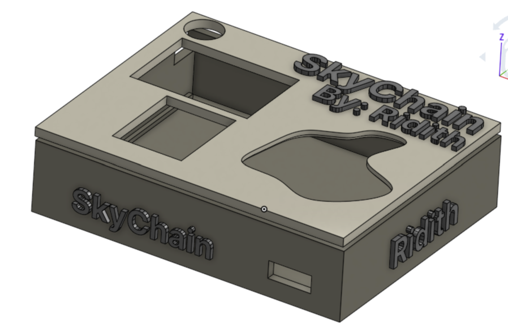
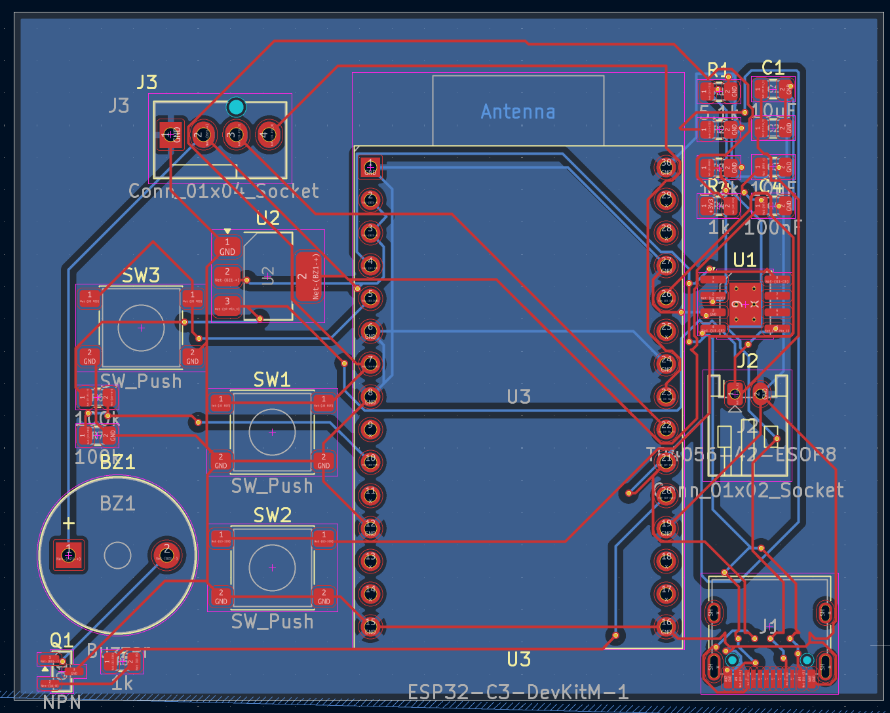

# SkyChain

SkyChain is a compact, wearable smart keychain designed to clip onto your belt, fit in your pocket, or go anywhere with you. Whenever you spot a plane flying overhead or want to check real-time flight telemetry, SkyChain delivers live aircraft tracking data directly to your OLED screen.

---

## Overview & How It Works

SkyChain fetches live overhead tracking data via the **OpenSky Network API** to give you real-time details about aircraft above you:

- **Flight Callsign & Identification**
- **Country of Origin**
- **Altitude & Flight Height**

Every time SkyChain queries the OpenSky API or receives updated telemetry, it updates its onboard display to show current flight tracking data.

---

## Core Features

- **Real-Time Flight Tracking**: Connects via Wi-Fi to the OpenSky REST API for live aircraft callsigns, countries, and altitude metrics.
- **Interactive Multi-Function UI**: Controlled via a 2-button tactile layout supporting single clicks, double-clicks, and long-presses to navigate menus.
- **Visual Display**: Integrated high-contrast 128x64 SSD1306 OLED screen for displaying clear flight stats and system menus.
- **Autonomous Battery Management**: Onboard USB-C charging and LiPo battery regulation for untethered daily wear.
- **Compact Keychain Form Factor**: Portable, lightweight hardware layout designed for everyday carry with an integrated spline window and acrylic viewing pane.

---

## Custom Hardware Design

Designing and routing the printed circuit board and 3D-printed enclosure has been an exciting hardware challenge:

- **Microcontroller Core**: ESP32 module managing Wi-Fi requests, display driving, and button debounce logic.
- **Power System**: Lithium battery charging paired with a low-dropout regulator and USB-C power delivery.
- **Enclosure Geometry**: Custom CAD model featuring a 2.0 mm wall enclosure, reinforced keychain mount, and a recessed internal ledge for a flush-fit acrylic window.
- **Optimized Passives**: SMD passive array for power decoupling, USB pull-downs, and robust circuit stability.
- THIS WAS MY 3RD PCB DESIGN AND PROLLY THE MOST COMPLEX IVE MADE!!
  
